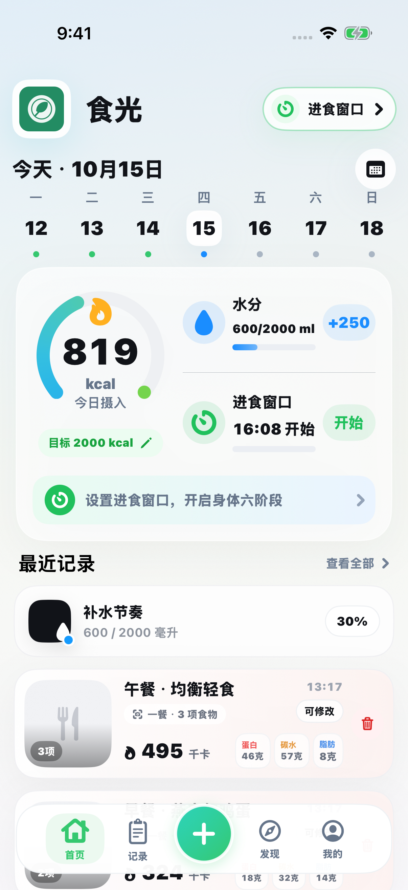
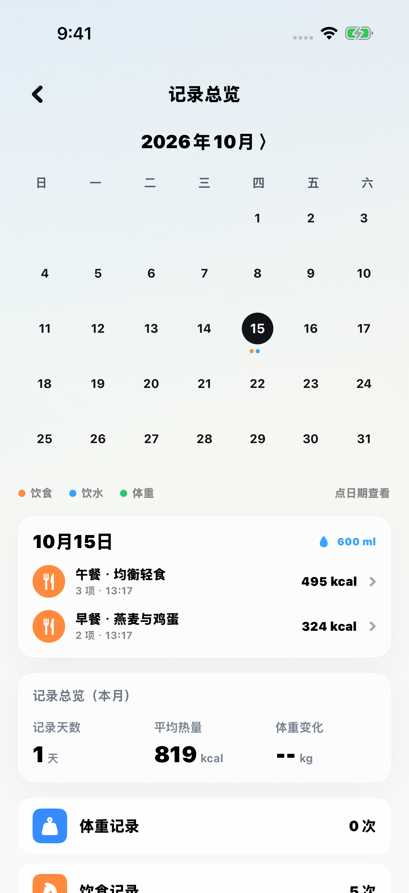
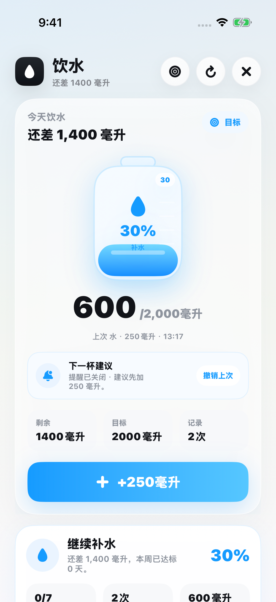
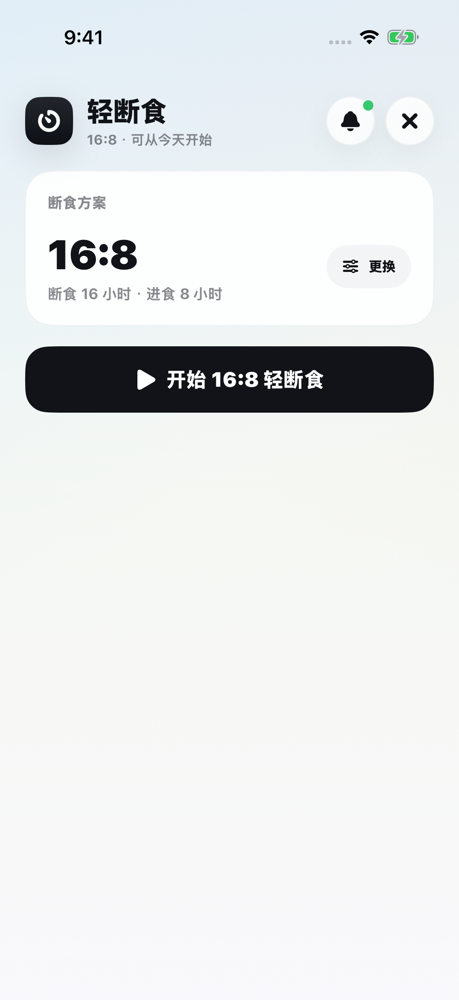

# LightCal · 食光

一个无需自建服务器的开源 iOS 饮食与健康记录应用。照片识别和聊天由手机直接调用通义千问，使用用户自己的 API Key；饮食、饮水、体重、运动、睡眠和断食记录保存在本机。仓库中的 FastAPI 服务保留用于独立研究与开发。

A server-free SwiftUI app with on-device records and direct Qwen photo/chat calls using your own API key. The Python backend remains optional research tooling.

## 界面预览

以下截图于 2026 年 10 月 15 日从当前开源版本重新运行截取，使用独立演示数据。设备为 iPhone 17 Pro 模拟器（iOS 26.0）。

| 首页 | 记录总览 |
| --- | --- |
|  |  |
| 饮水记录 | 轻断食 |
|  |  |

## 功能

- 拍照或从相册选择食物照片，千问估算整份克重和营养；无需深度相机或 GPU 服务。
- 千问多轮聊天；可选择将最近 7 天本机记录作为参考，默认关闭记录发送。
- 设置中验证、更换、删除用户自己的百炼 Key；Key 存入本机系统钥匙串，不进入导出数据。
- 手动及文字记录、基础食物搜索、常用餐食、饮水、运动、体重、睡眠、步数、断食和每日汇总。
- Apple 健康授权、提醒、本机 JSON 数据导出和删除。

本机版不提供好友动态、跨设备云同步或外卖下单。原后端实验性评分、菜谱生成和深度分析接口不属于本机版功能。营养和份量均为估算，请确认后保存；建议不能替代医疗建议。

## 运行 iOS App

使用 macOS、Xcode 26 或更新版本，部署目标为 iOS 17.0。

1. 打开 `ios/CalAI.xcodeproj`，选择 `CalAI` scheme。
2. 在 Signing & Capabilities 中选择自己的开发团队；分发时使用自己有权限的 Bundle Identifier。
3. 直接运行。记录与统计无需后端、Python、数据库服务或局域网地址。
4. 打开“我的 → 设置 → 千问 API Key”，选择 Key 所属地域，填写自己的百炼 Key，阅读数据发送说明后开启授权，点击“验证并保存”。验证分别调用聊天和图片模型，可能产生少量费用。
5. 普通记录可以离线使用；千问图片识别、聊天和文字估算需要联网。Apple 健康、相机及语音输入按需请求系统权限。

记录保存在应用沙盒的 `Application Support/LightCal/local-records-v1.json`，使用受保护的原子写入。应用不提供开发者服务器云备份；卸载前请导出。Key 使用 `WhenUnlockedThisDeviceOnly` 钥匙串项，不随应用数据导出或跨设备同步。系统设备备份行为由用户的系统设置决定。

[隐私说明](docs/privacy.md) · [发布准备](docs/app-store.md)

## 可选：运行研究后端

以下 Python / Docker 步骤仅用于独立研究。**iOS 本机版不会连接这些接口。**

需要 Python 3.12 或更新版本。建议使用独立虚拟环境。

```bash
git clone https://github.com/het2333/lightcal.git
cd lightcal
python3.12 -m venv .venv
source .venv/bin/activate
pip install -r requirements.txt
cp .env.example .env
```

编辑 `.env`，填入自己的 `QWEN_API_KEY`，然后启动：

```bash
uvicorn server:app --host 127.0.0.1 --port 8001
```

- 健康检查：<http://127.0.0.1:8001/>
- API 文档：<http://127.0.0.1:8001/docs>
- 餐食分析：`POST /v6/describeMeal`

首次启动会创建本地 SQLite 数据库，并加入源码内置的小型食物示例库。完整营养库、菜谱库、个人记录和模型权重需要自行准备。未配置模型密钥时，部分记录功能仍可使用，图片识别不可用；文字接口可能返回演示用回退结果。

请将项目放在支持 SQLite 的本地文件系统上。部分外置 exFAT 卷会出现 `SQLITE_READONLY_DBMOVED`，此时应将项目克隆到系统磁盘再运行。

### Docker

```bash
cp .env.example .env
# 在 .env 中配置模型密钥
docker compose up --build
```

数据保存在本地 `data/`，上传图片保存在 `static/uploads/`；这两个目录挂载到容器并被 Git 忽略。

## iOS 图片识别流程

1. 手机读取本机钥匙串中的用户 Key，直接通过 HTTPS 调用所选地域的百炼接口。
2. 使用 `qwen3-vl-plus` 分析主照片，可附带最多 4 张辅助照片；聊天和文字估算使用 `qwen-plus`。
3. 严格解析整份营养 JSON，拒绝不完整结果、负数及明显不合理的重量/热量组合，不用零值伪造识别成功。
4. 用户检查、修改并确认后，记录与照片保存到手机。

API Key、照片和聊天内容不会经过开发者服务器。照片及文字会发送给用户选择的阿里云地域，调用费用由用户的百炼账户承担。撤回授权或关闭记录发送会立即保存在本机，无需再次调用模型。

独立 Python 研究服务另有数据库校准、两阶段复核和 GPU 深度实验模式，见 [架构与配置](docs/architecture.md)。

## 测试

在仓库根目录运行，使用测试替身而非真实模型密钥：

```bash
swift test
python -m pytest tests -q
```

iOS 模拟器编译：

```bash
xcodebuild -project ios/CalAI.xcodeproj -scheme CalAI \
  -configuration Debug -sdk iphonesimulator \
  -destination 'generic/platform=iOS Simulator' \
  CODE_SIGNING_ALLOWED=NO build
```

CI 自动运行 Swift 核心测试、Python 测试和 iOS 模拟器编译；`iOS offline flows` 使用真实 App 的测试目标验证本机记录解码和千问设置界面，不启动后端。

## 目录

```text
server.py       FastAPI 接口与单用户应用入口
services/       模型适配、食物数据库、营养计算与记录服务
models/         Pydantic 数据模型
engine/         规则表达式解析与计算
prompts/        图片识别及营养复核提示词
ios/CalAI/      SwiftUI App 源码
data/rules/     示例规则
scripts/        数据处理和实验工具
tests/          自动化测试
```

`scripts/` 中的模型训练、数据采集和云端脚本属于可选研究工具，保留了原实验环境的目录约定；运行前应阅读脚本并配置依赖和路径。主应用启动不依赖这些工具。

## 数据、依赖与部署边界

- 仓库不包含商业 App 安装包或其解包资源、第三方 SDK 二进制、用户照片、健康记录、私有数据库、密钥或模型权重。
- 源码中的历史 `CalAI` 名称及兼容接口沿用开发时命名；本项目与同名商业产品无隶属或授权关系。
- MIT 许可证适用于本仓库自有代码。第三方服务、模型与数据集按各自条款使用，见 [第三方说明](THIRD_PARTY_NOTICES.md)。
- 后端使用固定单用户上下文，未实现面向公网的用户认证和访问隔离。请在本机或受信任网络使用；公网部署需要自行增加认证、HTTPS、访问限制与数据保护。

## 贡献与许可

欢迎通过 Issue 报告可复现的问题，或提交带验证说明的 Pull Request。请勿提交密钥、真实个人记录、未获授权的数据或商业 App 素材。

项目采用 [MIT License](LICENSE)。
